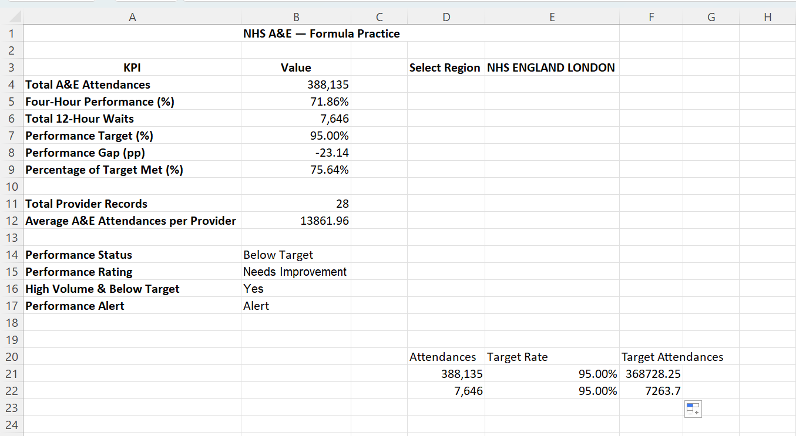

# 🧮 Excel Formulas & Functions — NHS A&E Performance Analysis

## 📊 Project Overview

This Excel practice exercise demonstrates how essential Excel formulas and functions can be used to analyse NHS England Accident & Emergency (A&E) attendance data.

Using the October 2023 NHS A&E dataset, I developed a **criteria-driven KPI summary** that automatically calculates regional performance based on a selected NHS England region.

The objective was to practise conditional calculations, logical functions, error handling, cell references, and performance analysis using real-world healthcare data.

**Key Questions:**
- How many A&E attendances were recorded in the selected region?
- What percentage of attendances were completed within four hours?
- How far is the selected region from the 95% performance standard?
- How many patients experienced 12-hour waits?
- What percentage of the performance target was achieved?

> **Project Type:** Independent Excel learning and portfolio practice exercise.

---

## 🛠️ Tools & Technologies

| Tool / Function | Purpose |
|---|---|
| Microsoft Excel | Data analysis and KPI development |
| SUM / SUMIFS | Attendance and waiting-time calculations |
| COUNTIFS | Counting records based on regional criteria |
| AVERAGEIFS | Calculating average provider-record attendances |
| IF / IFS | Performance classification |
| AND / OR | Logical conditions and alerts |
| IFERROR | Handling calculation errors |
| ROUND | Rounding performance differences |
| Cell References | Relative and absolute reference practice |

---

## 📁 Dataset Information

**Source:** NHS England — A&E Attendances and Emergency Admissions

**Reporting Period:** October 2023  
**Geographical Coverage:** England  
**Data Level:** NHS provider-level records  
**Selected Region for Demonstration:** NHS England London

**Official Source:**  
https://www.england.nhs.uk/statistics/statistical-work-areas/ae-waiting-times-and-activity/

The dataset contains information about A&E attendances, waiting times, emergency admissions, NHS providers, and regional groupings.

The original CSV file was imported into Microsoft Excel for formula-based analysis.

**Data Preparation:**
- Imported the October 2023 CSV file.
- Created a `Total A&E Attendances` column.
- Created a `Total Attendances Over 4 Hours` column.
- Excluded the national summary row from regional aggregations to prevent double-counting.
- Used a region selection cell to control the KPI calculations.

---

## 📂 Workbook Structure

| Worksheet | Description |
|---|---|
| `NHS_AE_Data` | Original NHS A&E data and calculated attendance columns |
| `Formula_Practice` | Regional KPI summary, conditional formulas, and reference demonstrations |

---

## 🧮 Excel Formulas & Calculations

### 1. Total A&E Attendances — SUM

```excel
=SUM(E2:J2)
```

**Purpose:** Adds six attendance categories for each provider record.

### 2. Total Attendances Over Four Hours — SUM

```excel
=SUM(K2:P2)
```

**Purpose:** Adds recorded attendances exceeding four hours across six categories.

### 3. Regional A&E Attendances — SUMIFS

```excel
=SUMIFS(NHS_AE_Data!$W$2:$W$204,NHS_AE_Data!$C$2:$C$204,$E$3)
```

**Purpose:** Calculates total attendances for the region selected in cell `E3`.

### 4. Regional 12-Hour Waits — SUMIFS

```excel
=SUMIFS(NHS_AE_Data!$R$2:$R$204,NHS_AE_Data!$C$2:$C$204,$E$3)
```

**Purpose:** Calculates patients waiting 12 or more hours from decision to admit to admission.

### 5. Four-Hour Performance (%) — IFERROR + SUMIFS

```excel
=IFERROR((B4-SUMIFS(NHS_AE_Data!$X$2:$X$204,NHS_AE_Data!$C$2:$C$204,$E$3))/B4,0)
```

**Purpose:** Calculates the percentage of recorded attendances completed within four hours.

### 6. Performance Gap — ROUND

```excel
=ROUND((B5-B7)*100,2)
```

**Purpose:** Measures the difference between actual performance and the 95% benchmark in percentage points.

### 7. Percentage of Target Met — IFERROR

```excel
=IFERROR(B5/B7,0)
```

**Purpose:** Calculates actual performance as a proportion of the target.

### 8. Total Provider Records — COUNTIFS

```excel
=COUNTIFS(NHS_AE_Data!$C$2:$C$204,$E$3)
```

**Purpose:** Counts records belonging to the selected region.

### 9. Average A&E Attendances — AVERAGEIFS

```excel
=IFERROR(AVERAGEIFS(NHS_AE_Data!$W$2:$W$204,NHS_AE_Data!$C$2:$C$204,$E$3),0)
```

**Purpose:** Calculates average attendances per provider record for the selected region.

### 10. Performance Status — IF

```excel
=IF(B5>=B7,"Target Met","Below Target")
```

**Purpose:** Identifies whether the selected region meets the four-hour performance target.

### 11. Performance Rating — IFS

```excel
=IFS(B5>=B7,"Excellent",B5>=80%,"Good",B5>=70%,"Needs Improvement",TRUE,"Critical")
```

**Purpose:** Assigns a practice performance category using defined thresholds.

### 12. High Volume and Below Target — AND

```excel
=IF(AND(B4>100000,B5<B7),"Yes","No")
```

**Purpose:** Identifies high-attendance regions performing below target.

### 13. Performance Alert — OR

```excel
=IF(OR(B5<70%,B6>5000),"Alert","Normal")
```

**Purpose:** Triggers a practice alert when either condition is met.

### 14. Relative and Absolute References

**Relative Reference:**

```excel
=D21*E21
```

When copied down:

```excel
=D22*E22
```

**Absolute Reference:**

```excel
$E$3
```

**Purpose:** Demonstrates how relative references change when formulas are copied, while absolute references remain fixed.

---

## 📈 KPI Summary — NHS England London

| KPI | Result |
|---|---:|
| Total A&E Attendances | **388,135** |
| Four-Hour Performance | **71.86%** |
| Total 12-Hour Waits | **7,646** |
| Performance Target | **95.00%** |
| Performance Gap | **-23.14 pp** |
| Percentage of Target Met | **75.64%** |
| Provider Records | **28** |
| Average Attendances per Provider Record | **13,861.96** |
| Performance Status | **Below Target** |
| Performance Rating | **Needs Improvement** |
| High Volume & Below Target | **Yes** |
| Performance Alert | **Alert** |

*These results reflect the October 2023 dataset and the selected London region. Provider records do not necessarily represent unique NHS organisations.*

---

## 🔍 Key Findings

### Finding 1 — Four-Hour Performance Below Target

London recorded **71.86%** four-hour performance in the practice dataset, representing a **23.14 percentage-point gap** below the 95% standard.

### Finding 2 — Significant 12-Hour Waiting Times

The selected region recorded **7,646 patients waiting 12 or more hours** from decision to admit to admission.

This triggered the workbook's practice alert condition.

### Finding 3 — Attendance Volume and Provider Activity

The region recorded **388,135 A&E attendances** across **28 provider records**, with average attendances of approximately **13,862 per record**.

---

## 🎯 Skills Demonstrated

- Excel data import and preparation
- Relative and absolute references
- Conditional aggregation using SUMIFS
- Conditional counting using COUNTIFS
- Conditional averaging using AVERAGEIFS
- Logical decision-making using IF and IFS
- Multiple-condition evaluation using AND and OR
- Error handling using IFERROR
- Percentage and performance-gap calculations
- KPI summary development
- Regional healthcare performance analysis

---

## 🖼️ Excel Practice Preview



*Criteria-driven NHS A&E KPI summary showing regional attendance, waiting-time and performance calculations.*

---

## 📂 Project Files

| File | Description |
|---|---|
| `formulas_practice.xlsx` | Excel workbook containing the imported data and formula practice |
| `screenshots/formulas_practice.png` | Screenshot of the completed KPI summary |
| `README.md` | Exercise documentation |
| `../data/NHS_AE_Source_Files/` | Shared NHS England source CSV files |

---

## 📚 Learning Outcome

This exercise strengthened my practical understanding of Excel formulas through a healthcare performance analysis scenario.

I practised transforming raw A&E attendance records into a region-specific KPI summary, applying conditional calculations, evaluating performance against a benchmark, and using logical functions to classify results.

The exercise also demonstrates how a single criteria cell can drive multiple calculations without manually filtering the dataset.

---

## ⚠️ Important Notes

- This is an independent Excel portfolio practice exercise, not an official NHS England performance report.
- The analysis uses October 2023 data only.
- The 95% four-hour standard is used as a comparison benchmark.
- Performance ratings and alert thresholds are illustrative practice rules, not official NHS classifications.
- The workbook's region selection is a manually editable criteria cell, not an Excel slicer.
- The relative-reference demonstration is instructional and does not represent an additional NHS performance metric.

---

## 📌 Data Source

**NHS England — A&E Attendances and Emergency Admissions**

https://www.england.nhs.uk/statistics/statistical-work-areas/ae-waiting-times-and-activity/