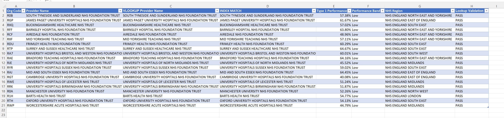

# 🔎 Excel Lookups — NHS A&E Provider Analysis

## 📊 Project Overview

This Excel practice exercise demonstrates how lookup functions can be used to retrieve and validate NHS England Accident & Emergency (A&E) organisation information.

Using the October 2023 NHS A&E dataset, I created a separate provider lookup table and applied XLOOKUP, VLOOKUP, and INDEX/MATCH to 20 selected organisation codes. I also retrieved NHS regional groupings, calculated Type 1 four-hour performance, assigned illustrative performance bands, and checked whether the three name lookup methods agreed.

The objective was to practise exact and approximate lookups, structured references, and validation using real-world healthcare data.

**Key Questions:**

- How can organisation names be retrieved from NHS organisation codes?
- Do XLOOKUP, VLOOKUP, and INDEX/MATCH produce consistent names?
- How can NHS regional groupings be added from a separate reference sheet?
- How can calculated Type 1 four-hour performance be grouped into bands?

**Project Type:** Independent Excel learning and portfolio practice exercise.

## 🛠️ Tools & Technologies

| Tool / Function | Purpose |
|---|---|
| Microsoft Excel | Data preparation and formula practice |
| XLOOKUP | Retrieve organisation names and NHS regions |
| VLOOKUP | Exact-match organisation name lookup |
| INDEX / MATCH | Alternative exact-match organisation name lookup |
| LOOKUP | Approximate-match performance banding |
| IF / AND | Validate agreement across lookup results |
| Excel Tables | Structure source and results data |
| Structured References | Reference named table columns |

## 📁 Dataset Information

**Source:** NHS England — A&E Attendances and Emergency Admissions  
**Reporting Period:** October 2023  
**Geographical Coverage:** England  
**Data Level:** NHS organisation/provider-level records  
**Selected Organisations for Demonstration:** 20

**Official Source:**  
https://www.england.nhs.uk/statistics/statistical-work-areas/ae-waiting-times-and-activity/

The original CSV includes organisation codes, organisation names, parent organisations (NHS England regional groupings), Type 1 A&E attendances, and attendances exceeding four hours.

**Data Preparation:**

1. Imported the original October 2023 CSV into Excel as the `October_2023` table.
2. Copied organisation codes, parent organisations, and organisation names into the `Provider_Lookup` worksheet.
3. Converted the reference data into an Excel Table named `tblProviders`.
4. Selected 20 organisation codes for lookup practice.
5. Formatted the results as the `tblLookupPractice` Excel Table.

## 📂 Workbook Structure

| Worksheet | Description |
|---|---|
| `AE_Data` | Imported original NHS A&E data (`October_2023`) |
| `Provider_Lookup` | Separate organisation reference table (`tblProviders`) |
| `Lookup_Practice` | Lookup comparisons, Type 1 performance, bands, regions, and validation |

## 🧮 Excel Formulas & Calculations

### 1. Organisation Name — XLOOKUP

```excel
=XLOOKUP(A2,tblProviders[Org Code],tblProviders[Org name],"Not Found")
```

**Purpose:** Finds the organisation code in the reference table and returns its organisation name.

### 2. Organisation Name — VLOOKUP

```excel
=VLOOKUP(A2,tblProviders[[Org Code]:[Org name]],3,FALSE)
```

**Purpose:** Returns the name from the third column of the lookup range. `FALSE` requests an exact match.

### 3. Organisation Name — INDEX / MATCH

```excel
=INDEX(tblProviders[Org name],MATCH(A2,tblProviders[Org Code],0))
```

**Purpose:** `MATCH` locates the code and `INDEX` retrieves the name at that position. `0` requests an exact match.

### 4. NHS Region — XLOOKUP

```excel
=XLOOKUP(A2,tblProviders[Org Code],tblProviders[Parent Org],"Not Found")
```

**Purpose:** Adds the NHS England regional grouping associated with each organisation code.

### 5. Type 1 Four-Hour Performance

```excel
=1-XLOOKUP(A2,October_2023[Org Code],October_2023[Attendances over 4hrs Type 1])/XLOOKUP(A2,October_2023[Org Code],October_2023[A&E attendances Type 1])
```

**Purpose:** Calculates the proportion of Type 1 attendances not recorded as exceeding four hours.

**Calculation:** `(Type 1 Attendances − Type 1 Attendances Over 4 Hours) / Type 1 Attendances`

### 6. Approximate Match — Performance Band

```excel
=LOOKUP(E2,{0,0.7,0.85},{"Low","Medium","High"})
```

**Purpose:** Assigns a practice category by matching the percentage to the largest threshold not exceeding it.

| Type 1 Performance | Practice Band |
|---|---|
| Below 70% | Low |
| 70% to below 85% | Medium |
| 85% or above | High |

These are illustrative practice categories, not official NHS classifications.

### 7. Lookup Validation — IF / AND

```excel
=IF(AND(B2=C2,C2=D2),"PASS","FAIL")
```

**Purpose:** Checks whether XLOOKUP, VLOOKUP, and INDEX/MATCH return identical organisation names for each selected code.

## 📈 Lookup Results — 20 NHS Organisations

| KPI | Result |
|---|---|
| Selected Organisation Codes | 20 |
| XLOOKUP, VLOOKUP, INDEX/MATCH | Applied to all 20 codes |
| Lookup Validation | 20 PASS |
| Validation Failures | 0 |
| Illustrative Performance Band | Low for all 20 selected records |

Results refer to the selected October 2023 records, not all NHS providers.

## 🔍 Key Findings

### Finding 1 — Consistent Name Lookup Results

All 20 selected organisation codes returned matching names using XLOOKUP, VLOOKUP, and INDEX/MATCH. The comparison formula showed **20 PASS** results.

### Finding 2 — Organisation Information Retrieved from a Separate Sheet

The `tblProviders` reference table supplied organisation names and NHS regional groupings without manually retyping them into the practice sheet.

### Finding 3 — Selected Records Fell into the Low Practice Band

All 20 selected records were classified as **Low** under the illustrative threshold of below 70%. This does not represent an official NHS rating or national ranking.

## 🎯 Skills Demonstrated

- Importing NHS CSV data into Excel
- Building and formatting Excel Tables
- Using structured references
- Exact-match XLOOKUP and VLOOKUP
- Combining INDEX and MATCH
- Retrieving organisation names and NHS regions
- Approximate-match banding with LOOKUP
- Calculating Type 1 four-hour performance
- Comparing results with IF and AND
- Validating results across 20 selected codes

## 🖼️ Excel Practice Preview



*Lookup practice showing provider names, Type 1 performance, practice bands, NHS regions, and validation results.*

## 📂 Project Files

| File | Description |
|---|---|
| `lookups_practice.xlsx` | Excel workbook with original data, lookup reference, and formula practice |
| `screenshots/lookups_practice.png` | Screenshot of the completed lookup table |
| `README.md` | Project documentation and key formulas |
| `../data/NHS_AE_Source_Files/` | Shared NHS England source CSV files |

## 📚 Learning Outcome

This exercise strengthened my understanding of how to use different Excel lookup methods to enrich and validate records. I practised retrieving organisation details from a separate reference table, applying exact and approximate matching, calculating a performance percentage, and checking consistency across formulas.

## ⚠️ Important Notes

- This is an independent Excel portfolio practice exercise, not an official NHS England performance report.
- The exercise uses October 2023 data and 20 selected organisation codes only.
- The performance calculation covers **Type 1 A&E attendances**, not all A&E types.
- Low, Medium, and High are illustrative learning bands, not official NHS classifications.
- The 20 PASS results confirm agreement between the three lookup methods; they do not independently audit the NHS source data.
- The performance formula assumes a nonzero Type 1 attendance denominator for the selected records.

## 📌 Data Source

**NHS England — A&E Attendances and Emergency Admissions**

https://www.england.nhs.uk/statistics/statistical-work-areas/ae-waiting-times-and-activity/
