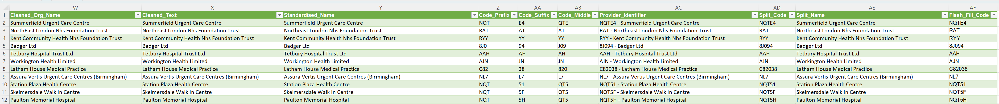
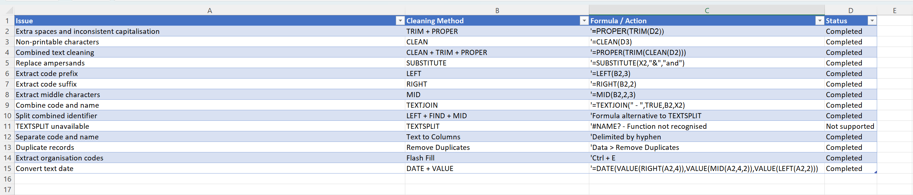
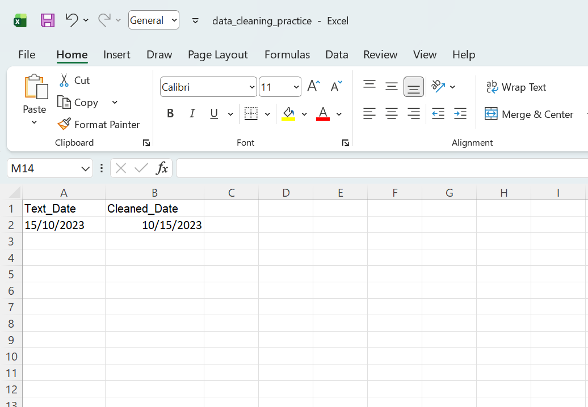

# 🧹 Excel Data Cleaning — NHS A&E Provider Data

## 📊 Project Overview

This independent Excel practice exercise demonstrates how to identify, clean, standardise, and document data-quality issues using NHS England Accident & Emergency (A&E) provider-level data.

Using the October 2023 NHS A&E dataset, I imported the original CSV into Excel, created a separate working dataset, deliberately introduced selected text-quality issues, and applied Excel formulas and built-in cleaning tools.

The exercise also includes text extraction, combining and splitting values, duplicate removal, Flash Fill, text-to-date conversion, and a structured cleaning log.

**Key Questions:**

- How can extra spaces and non-printable characters be removed from organisation names?
- How can Excel formulas extract, combine, and split organisation identifiers?
- How can duplicates and text-formatted dates be handled?
- How can cleaning issues, methods, and actions be documented?
- What alternatives can be used when a function is unavailable?

**Project Type:** Independent Excel learning and portfolio practice exercise.

## 🛠️ Tools & Technologies

| Tool / Function | Purpose |
|---|---|
| Microsoft Excel | Data preparation and cleaning practice |
| Power Query | Import the original NHS CSV |
| TRIM / CLEAN / PROPER | Clean spaces, non-printable characters, and capitalisation |
| SUBSTITUTE | Replace selected characters in text |
| LEFT / MID / RIGHT | Extract characters from organisation codes |
| TEXTJOIN | Combine organisation codes and names |
| FIND / LEN | Locate delimiters and calculate text lengths |
| Text to Columns | Split combined identifiers |
| Remove Duplicates | Remove duplicate practice records |
| Flash Fill | Extract codes from examples |
| DATE / VALUE | Convert a text date into an Excel date |
| Excel Tables | Structure cleaning results and the cleaning log |

## 📁 Dataset Information

**Source:** NHS England — A&E Attendances and Emergency Admissions  
**Reporting Period:** October 2023  
**Geographical Coverage:** England  
**Data Level:** NHS organisation/provider-level records

**Official Source:**  
https://www.england.nhs.uk/statistics/statistical-work-areas/ae-waiting-times-and-activity/

The imported dataset contains organisation codes, parent organisations, organisation names, A&E attendances, and related performance measures.

**Data Preparation:**

1. Imported the October 2023 NHS A&E CSV into Excel.
2. Preserved the imported data in the `Raw_Data` worksheet.
3. Created a separate `Messy_Data` worksheet for cleaning practice.
4. Deliberately introduced extra spaces and a line-break character into selected organisation names.
5. Applied cleaning formulas and Excel features.
6. Documented the exercises in a structured `Cleaning_Log` worksheet.

## 📂 Workbook Structure

| Worksheet | Description |
|---|---|
| `Raw_Data` | Original imported NHS A&E data |
| `Messy_Data` | Practice data with cleaning formulas and extracted values |
| `Text_to_Columns` | Splitting provider identifiers and removing duplicates |
| `Date_Cleaning` | Converting a text-formatted date into a valid Excel date |
| `Cleaning_Log` | Records cleaning issues, methods, formulas or actions, and status |

## 🧮 Excel Formulas & Cleaning Techniques

### 1. TRIM and PROPER — Organisation Name

```excel
=PROPER(TRIM(D2))
```

**Purpose:** Removes unnecessary leading, trailing, and repeated spaces and converts text into title case.

**Practice Example:** A deliberately modified organisation name containing extra spaces.

### 2. CLEAN — Non-Printable Characters

```excel
=CLEAN(D3)
```

**Purpose:** Removes non-printable characters, including a deliberately introduced line break.

### 3. Combined Text Cleaning

```excel
=PROPER(TRIM(CLEAN(D2)))
```

**Purpose:** Combines three text-cleaning functions to remove non-printable characters, normalise spacing, and apply title case.

### 4. SUBSTITUTE — Text Standardisation

```excel
=SUBSTITUTE(X2,"&","and")
```

**Purpose:** Replaces ampersands with the word `and` as an illustrative standardisation exercise.

### 5. LEFT — Extract Code Prefix

```excel
=LEFT(B2,3)
```

**Purpose:** Extracts the first three characters of an organisation code.

### 6. RIGHT — Extract Code Suffix

```excel
=RIGHT(B2,2)
```

**Purpose:** Extracts the final two characters of an organisation code.

### 7. MID — Extract Code Characters

```excel
=MID(B2,2,3)
```

**Purpose:** Extracts three characters beginning at the second character of the organisation code.

### 8. TEXTJOIN — Combine Organisation Details

```excel
=TEXTJOIN(" - ",TRUE,B2,X2)
```

**Purpose:** Combines the organisation code and cleaned organisation name into a single provider identifier.

### 9. Split Organisation Code — LEFT and FIND

```excel
=LEFT(AC2,FIND(" - ",AC2)-1)
```

**Purpose:** Extracts the organisation code appearing before the delimiter.

### 10. Split Organisation Name — MID, FIND, LEN and TRIM

```excel
=TRIM(MID(AC2,FIND(" - ",AC2)+3,LEN(AC2)))
```

**Purpose:** Extracts the organisation name appearing after the delimiter.

### 11. TEXTSPLIT — Compatibility Test

The following function was tested:

```excel
=TEXTSPLIT(AC2," - ")
```

It returned `#NAME?` in the Excel environment used for this exercise.

**Alternative:** Used `LEFT`, `MID`, `FIND`, `LEN`, and `TRIM` to extract the code and name separately.

### 12. Text to Columns

**Method:** Data → Text to Columns → Delimited → Other → Hyphen.

**Purpose:** Split a combined provider identifier into separate organisation code and organisation name columns.

### 13. Remove Duplicates

**Method:** Data → Remove Duplicates.

**Purpose:** Remove an intentionally duplicated practice record from the `Text_to_Columns` worksheet.

### 14. Flash Fill

**Shortcut:** `Ctrl + E`

**Purpose:** Extract organisation codes from combined provider identifiers using a manually entered example.

**Validation Note:** Flash Fill output should be compared with the source organisation codes before reuse.

### 15. Text Date Conversion

```excel
=DATE(VALUE(RIGHT(A2,4)),VALUE(MID(A2,4,2)),VALUE(LEFT(A2,2)))
```

**Purpose:** Converts a date stored as text in `DD/MM/YYYY` format into an Excel date value.

**Practice Example:** `15/10/2023`.

## 📋 Cleaning Log — 14 Activities

The `Cleaning_Log` worksheet documents 14 practice activities across four fields:

| Column | Description |
|---|---|
| Issue | Data-quality issue or practice task |
| Cleaning Method | Function or Excel feature applied |
| Formula / Action | Formula or steps used |
| Status | Completion or compatibility status |

The log includes text cleaning, code extraction, combining and splitting text, duplicate removal, Flash Fill, date conversion, and the unsupported `TEXTSPLIT` test.

## 🔍 Key Findings

### Finding 1 — Multiple Text Issues Can Be Addressed with Combined Formulas

The exercise demonstrated how `CLEAN`, `TRIM`, and `PROPER` can be combined to handle deliberately introduced non-printable characters, spacing issues, and inconsistent capitalisation.

### Finding 2 — Combined Identifiers Can Be Separated Without TEXTSPLIT

Although `TEXTSPLIT` returned `#NAME?`, alternative text functions successfully extracted organisation codes and names from the combined provider identifiers.

### Finding 3 — Cleaning Should Be Documented and Validated

The cleaning log recorded the methods and outcomes of 14 activities. Separate exercises also demonstrated duplicate removal, Flash Fill, and date conversion. These exercises illustrate the importance of maintaining an auditable cleaning process.

## 🎯 Skills Demonstrated

- Importing NHS CSV data into Excel
- Preserving original data separately from practice transformations
- Removing unnecessary spaces and non-printable characters
- Standardising text using formulas
- Extracting organisation-code components
- Combining and splitting text fields
- Using Text to Columns and Flash Fill
- Removing duplicate records
- Converting text-formatted dates
- Recording cleaning issues and corrective actions
- Working around unavailable Excel functions

## 🖼️ Excel Practice Preview

### Cleaning Results



*Cleaning formulas showing standardised organisation names, extracted codes, and combined identifiers.*

### Cleaning Log



*Structured log documenting cleaning issues, methods, formulas or actions, and status.*

### Date Cleaning



*Conversion of a text-formatted date into an Excel date value.*

## 📂 Project Files

| File | Description |
|---|---|
| `data_cleaning_practice.xlsx` | Excel workbook containing original data, cleaning exercises, and cleaning log |
| `screenshots/01-cleaning-results.png` | Formula-based cleaning results |
| `screenshots/02-cleaning-log.png` | Data-cleaning log |
| `screenshots/03-date-cleaning.png` | Text-to-date conversion |
| `README.md` | Project documentation and key formulas |
| `../data/NHS_AE_Source_Files/` | Shared NHS England source CSV files |

## 📚 Learning Outcome

This exercise strengthened my understanding of how to clean and prepare real-world data in Excel. I practised text-cleaning formulas, string extraction, combining and separating fields, removing duplicates, converting text dates, and recording data-quality issues in a structured log.

I also gained experience using alternative formulas when a newer Excel function was unavailable.

## ⚠️ Important Notes

- This is an independent Excel portfolio practice exercise, not an official NHS England data-quality assessment.
- Selected data-quality issues were deliberately introduced for learning purposes.
- Applying `PROPER` to organisation names can change official capitalisation and abbreviations.
- Replacing `&` with `and` is an illustrative transformation, not a verified correction to official organisation names.
- Organisation codes and names should be checked against authoritative reference data before operational use.
- `TEXTSPLIT` was unavailable in the tested Excel environment.
- Flash Fill results should be validated against source values.
- The date-conversion formula assumes a `DD/MM/YYYY` text format.

## 📌 Data Source

**NHS England — A&E Attendances and Emergency Admissions**

https://www.england.nhs.uk/statistics/statistical-work-areas/ae-waiting-times-and-activity/
