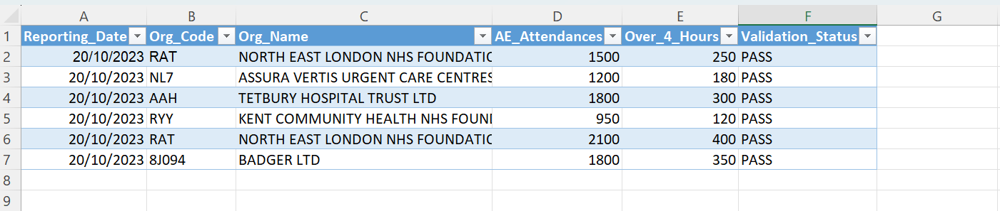
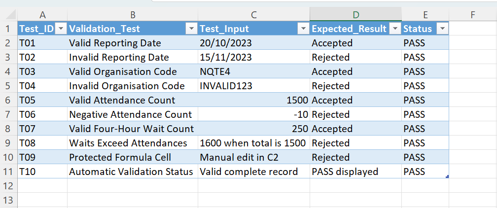

# 📋 Excel Tables & Data Validation — NHS A&E Data Entry

## 📊 Project Overview

This independent Excel practice exercise demonstrates how to create a structured and controlled data entry system using Microsoft Excel.

Using NHS England's October 2023 A&E provider dataset as a reference, I developed a data entry worksheet with Excel Tables, organisation code drop-down lists, automatic organisation name lookups, validation rules, and worksheet protection.

The objective was to practise building a reliable data entry workflow that reduces invalid entries and protects calculated fields from accidental modification.

**Key Questions:**

- How can Excel Tables organise data entry records?
- How can named ranges and drop-down lists restrict organisation codes?
- How can invalid dates and attendance values be rejected?
- How can formulas automatically identify incomplete or inconsistent records?
- How can worksheet protection prevent accidental formula changes?

**Project Type:** Independent Excel learning and portfolio practice exercise.

## 🛠️ Tools & Technologies

| Tool / Feature | Purpose |
|---|---|
| Microsoft Excel | Data entry and validation |
| Excel Tables | Structured data storage and formatting |
| Structured References | Refer to Excel Table columns |
| Named Ranges | Define the valid NHS organisation code list |
| Data Validation | Restrict invalid inputs |
| Drop-down Lists | Select valid organisation codes |
| XLOOKUP | Retrieve organisation names |
| IF / AND / OR | Evaluate validation conditions |
| COUNTIF | Check organisation code validity |
| DATE / ISNUMBER | Validate dates and numeric values |
| Worksheet Protection | Protect calculated cells |

## 📁 Dataset Information

**Source:** NHS England — A&E Attendances and Emergency Admissions  
**Reporting Period:** October 2023  
**Geographical Coverage:** England  
**Data Level:** NHS organisation/provider records  
**Imported Source Records:** 204  
**Demonstration Entries:** 6

**Official Source:**  
https://www.england.nhs.uk/statistics/statistical-work-areas/ae-waiting-times-and-activity/

The original NHS dataset provides organisation codes, organisation names, regional groupings and A&E activity statistics.

The data entry worksheet uses genuine organisation codes and reference names. Attendance and waiting-time values entered for this exercise are illustrative practice data, not official NHS statistics.

## 📂 Workbook Structure

| Worksheet | Description |
|---|---|
| `Temp_Data` | Imported October 2023 NHS A&E source data |
| `Provider_List` | Reference information for organisation codes and names |
| `Data_Entry` | Controlled entry form with validation and automatic calculations |
| `Validation_Log` | Documentation of validation test scenarios and expected outcomes |

## 🧮 Excel Formulas & Validation Rules

### 1. Organisation Name Lookup

```excel
=XLOOKUP(B2,Provider_List!B:B,Provider_List!D:D,"Invalid Code")
```

**Purpose:** Automatically retrieves the organisation name from the reference sheet using the selected organisation code.

*The lookup ranges should match the actual columns used in the workbook.*

### 2. Organisation Code Drop-down

**Named Range:**

```excel
NHS_Org_Codes
```

**Data Validation Settings:**

- Allow: List
- Source: `=NHS_Org_Codes`
- Error Alert: Stop

**Purpose:** Restricts organisation code entry to the permitted reference list.

### 3. Reporting Date Validation

**Validation Type:** Date

**Permitted Period:**

- Start: 01/10/2023
- End: 31/10/2023

**Purpose:** Rejects reporting dates outside October 2023.

### 4. Attendance Validation

**Validation Type:** Whole Number

**Rule:**

```excel
>=0
```

**Purpose:** Rejects negative attendance counts and non-integer values.

### 5. Four-Hour Waiting Count Validation

**Validation Type:** Custom

```excel
=AND(ISNUMBER(E2),E2>=0,MOD(E2,1)=0,ISNUMBER(D2),E2<=D2)
```

**Purpose:** Ensures the number of attendances exceeding four hours is a non-negative whole number and does not exceed total attendances.

### 6. Automatic Validation Status

```excel
=IF(COUNTA(A2,B2,D2,E2)=0,"",IF(OR(A2="",B2="",D2="",E2=""),"Incomplete",IF(AND(ISNUMBER(A2),A2>=DATE(2023,10,1),A2<=DATE(2023,10,31),COUNTIF(NHS_Org_Codes,B2)>0,ISNUMBER(D2),ISNUMBER(E2),D2>=0,E2>=0,E2<=D2),"PASS","CHECK")))
```

**Purpose:** Evaluates the completeness and consistency of each record.

| Result | Meaning |
|---|---|
| PASS | Record satisfies the formula's validation checks |
| CHECK | One or more validation conditions failed |
| Incomplete | Required information is missing |
| Blank | No input has been provided |

### 7. Date Type Verification

```excel
=ISNUMBER(A2)
```

**Purpose:** Confirms that Excel recognises the reporting date as a numeric date serial rather than text.

## 🔐 Worksheet Protection

The `Data_Entry` worksheet was configured to separate editable inputs from calculated fields.

| Columns | Access |
|---|---|
| Reporting_Date | Editable |
| Org_Code | Editable |
| Org_Name | Protected |
| AE_Attendances | Editable |
| Over_4_Hours | Editable |
| Validation_Status | Protected |

Worksheet protection helps prevent accidental changes to formulas while allowing users to enter permitted information.

## 🧪 Validation Testing

The workbook includes a `Validation_Log` documenting ten validation scenarios.

| Test | Expected Result |
|---|---|
| Valid October reporting date | Accepted |
| Date outside October 2023 | Rejected |
| Valid NHS organisation code | Accepted |
| Invalid organisation code | Rejected |
| Positive attendance count | Accepted |
| Negative attendance count | Rejected |
| Valid four-hour waiting count | Accepted |
| Four-hour waits greater than attendances | Rejected |
| Editing a protected formula cell | Rejected |
| Complete valid record | PASS |

The log records test outcomes for the demonstration workflow. It is not an independent audit of the original NHS data.

## 📈 Practice Results

| Metric | Result |
|---|---|
| Imported NHS source records | 204 |
| Demonstration data entry records | 6 |
| Records displaying PASS | 6 |
| Validation scenarios documented | 10 |
| Organisation name retrieval | Automated |
| Organisation code selection | Named-range drop-down |
| Formula protection | Enabled |

## 🔍 Key Findings

### Finding 1 — Controlled Organisation Code Entry

Using a named range and drop-down validation helped restrict entries to recognised organisation codes. Invalid manual codes were identified and rejected during testing.

### Finding 2 — Numeric Validation Reduced Inconsistent Entries

Attendance validation prevented negative values, while a custom rule rejected four-hour waiting counts exceeding total attendances.

### Finding 3 — Automatic Checks and Protection Improved Data Entry Reliability

The validation status formula displayed PASS for six completed demonstration records. Worksheet protection helped prevent accidental changes to calculated organisation names and validation results.

## 🎯 Skills Demonstrated

- Importing NHS CSV data into Excel
- Creating and resizing Excel Tables
- Working with structured data
- Using named ranges
- Creating organisation code drop-down lists
- Applying date and numeric validation rules
- Writing custom Data Validation formulas
- Retrieving organisation names automatically
- Using IF, AND, OR, COUNTIF and ISNUMBER
- Protecting calculated cells
- Testing invalid data entry scenarios
- Documenting validation results

## 🖼️ Excel Practice Preview

### Data Entry Worksheet



*Controlled Excel data entry table with organisation details, attendance values and validation results.*

### Validation Log



*Documented validation scenarios for dates, organisation codes, numeric values and protected cells.*

## 📂 Project Files

| File | Description |
|---|---|
| `tables_validation_practice.xlsx` | Excel workbook containing the data entry and validation exercise |
| `screenshots/01-data-entry.png` | Completed data entry worksheet |
| `screenshots/02-validation-log.png` | Validation test documentation |
| `README.md` | Project documentation and key formulas |
| `../data/NHS_AE_Source_Files/` | Shared NHS England source files |

## 📚 Learning Outcome

This exercise improved my understanding of designing controlled Excel data entry worksheets. I practised using Tables, named ranges, drop-down lists, formula-based checks, custom validation rules and worksheet protection to reduce incorrect entries and improve consistency.

## ⚠️ Important Notes

- This is an independent Excel portfolio practice exercise, not an official NHS England reporting system.
- The source organisation information comes from the October 2023 NHS A&E dataset.
- Demonstration attendance and waiting-time figures are illustrative.
- Worksheet protection is intended to prevent accidental changes, not provide strong security.
- Validation rules primarily control user entry; pasted or imported values may require additional checks.
- The validation status formula provides a secondary consistency check.
- The workbook is a learning exercise and should not be used as a production NHS data collection system.

## 📌 Data Source

**NHS England — A&E Attendances and Emergency Admissions**

https://www.england.nhs.uk/statistics/statistical-work-areas/ae-waiting-times-and-activity/