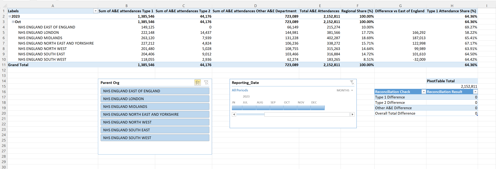
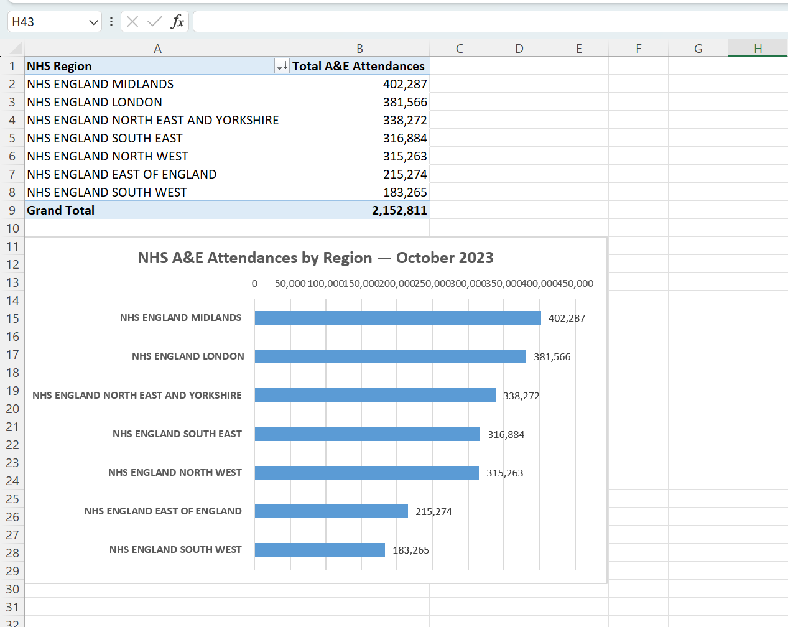
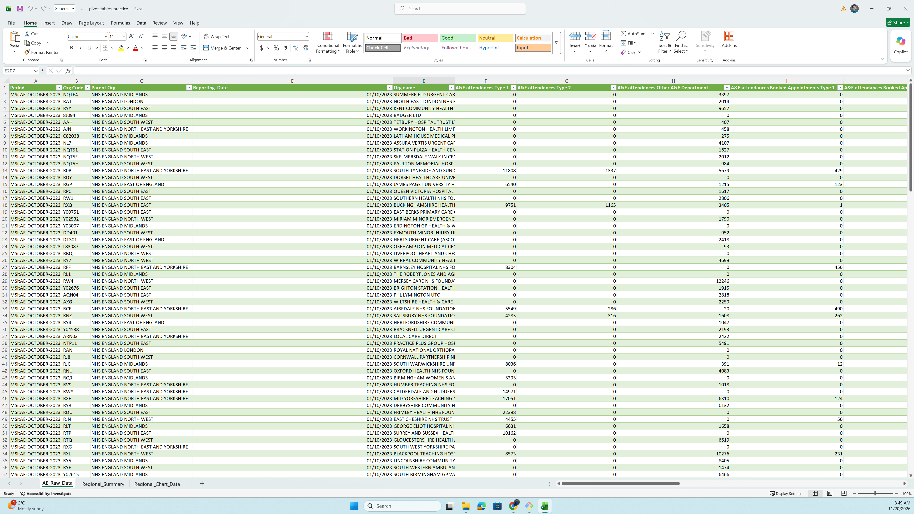

# 📊 Excel Pivot Tables — NHS A&E Regional Analysis

## 📊 Project Overview

This independent Excel practice exercise demonstrates how PivotTables, PivotCharts, slicers, timelines, and calculated fields can be used to analyse NHS England Accident & Emergency (A&E) attendance data.

Using the October 2023 NHS A&E dataset, I created regional summaries, calculated attendance totals and percentage shares, compared regional activity, and reconciled PivotTable results against the imported source data.

The objective was to practise summarising healthcare data, creating interactive reports, and verifying the accuracy of aggregated results.

**Key Questions:**

- How can NHS A&E attendances be summarised by region?
- Which NHS regions recorded the highest and lowest attendance volumes?
- How can PivotTables calculate regional percentage shares and differences?
- How can slicers and timelines support interactive filtering?
- Do PivotTable totals reconcile with the underlying NHS source data?

**Project Type:** Independent Excel learning and portfolio practice exercise.

## 🛠️ Tools & Technologies

| Tool / Feature | Purpose |
|---|---|
| Microsoft Excel | Data analysis and reporting |
| Power Query | Import and filter NHS source data |
| Excel Tables | Organise imported records |
| PivotTables | Aggregate attendance figures by region |
| Value Field Settings | Calculate percentages and differences |
| Calculated Fields | Calculate total attendance and Type 1 attendance share |
| Date Grouping | Group reporting dates by year and month |
| Slicers | Filter regional PivotTable results |
| Timelines | Filter data by reporting period |
| PivotCharts | Visualise regional attendance totals |
| SUM | Calculate and reconcile attendance totals |
| DATE / DATEVALUE | Convert reporting-period text into Excel dates |

## 📁 Dataset Information

**Source:** NHS England — A&E Attendances and Emergency Admissions  
**Reporting Period:** October 2023  
**Geographical Coverage:** England  
**Data Level:** NHS organisation/provider-level records  
**Original Imported Rows:** 204  
**Rows After Excluding Aggregate Total:** 203  
**NHS Regional Groups:** 7

**Official Source:**  
https://www.england.nhs.uk/statistics/statistical-work-areas/ae-waiting-times-and-activity/

The original dataset includes NHS organisation codes, organisation names, parent organisations, A&E attendance categories, waiting-time measures, and emergency admissions.

**Data Preparation:**

1. Imported the October 2023 NHS A&E CSV using Power Query.
2. Identified an existing aggregate `Total` record.
3. Excluded the aggregate record to prevent double counting.
4. Loaded the filtered data into an Excel Table.
5. Created a `Reporting_Date` column from the reporting-period text.
6. Built PivotTables using the cleaned data.

## 📂 Workbook Structure

| Worksheet | Description |
|---|---|
| `AE_Raw_Data` | Imported and filtered NHS A&E records |
| `Regional_Summary` | Regional PivotTable, calculated fields, slicer, timeline and reconciliation checks |
| `Regional_Chart_Data` | Separate PivotTable and PivotChart for comparing regional attendance volumes |

## 🧮 Excel Formulas & Calculations

### 1. Total A&E Attendances — Calculated Field

```excel
='A&E attendances Type 1'+'A&E attendances Type 2'+'A&E attendances Other A&E Department'
```

**Purpose:** Calculates combined attendances across the three main A&E department categories.

### 2. Regional Share — % of Grand Total

**PivotTable Setting:**

- Value Field: Total_AE_Attendances
- Show Values As: % of Grand Total

**Calculation:**

```text
Regional Attendance Share =
Regional Total Attendances / Grand Total Attendances
```

**Purpose:** Measures each NHS region's contribution to the overall attendance total.

### 3. Difference From — East of England

**PivotTable Settings:**

- Show Values As: Difference From
- Base Field: Parent Org
- Base Item: NHS ENGLAND EAST OF ENGLAND

**Calculation:**

```text
Attendance Difference =
Region Total Attendances - East of England Attendances
```

**Purpose:** Compares each region's attendance volume with the East of England baseline.

For example:

| NHS Region | Difference |
|---|---:|
| London | +166,292 |
| Midlands | +187,013 |
| South West | -32,009 |

These differences represent attendance volumes, not performance against a healthcare target.

### 4. Type 1 Attendance Share — Calculated Field

```excel
='A&E attendances Type 1'/('A&E attendances Type 1'+'A&E attendances Type 2'+'A&E attendances Other A&E Department')
```

**Purpose:** Calculates the proportion of total A&E attendances recorded under Type 1.

The result is displayed as a percentage.

### 5. Reporting Date Conversion

```excel
=DATE(VALUE(RIGHT(A2,4)),MONTH(DATEVALUE(MID(A2,8,LEN(A2)-12)&" 1")),1)
```

**Purpose:** Converts the October 2023 reporting-period text into a valid Excel date.

**Expected Result:** 01/10/2023

This allows date grouping and timeline filtering.

### 6. Raw Data Reconciliation

**Type 1 Difference:**

```excel
=B9-AE_Raw_Data!E205
```

**Type 2 Difference:**

```excel
=C9-AE_Raw_Data!F205
```

**Other A&E Difference:**

```excel
=D9-AE_Raw_Data!G205
```

These formulas were used before the PivotTable layout changed during date grouping.

### 7. Final Regional Reconciliation

After grouping dates by year and month, the reconciliation formulas were updated.

```excel
=B11-SUM(B4:B10)
```

```excel
=C11-SUM(C4:C10)
```

```excel
=D11-SUM(D4:D10)
```

```excel
=E11-SUM(E4:E10)
```

**Purpose:** Confirms that the sum of seven regional rows equals the corresponding PivotTable Grand Total.

All four final checks returned zero.

## 📈 PivotTable Results — October 2023

### A&E Attendance Summary

| Attendance Category | Total |
|---|---:|
| Type 1 A&E Attendances | 1,385,546 |
| Type 2 A&E Attendances | 44,176 |
| Other A&E Department Attendances | 723,089 |
| **Total A&E Attendances** | **2,152,811** |

### Additional Results

| KPI | Result |
|---|---|
| NHS Regional Groups | 7 |
| Highest Regional Attendance | Midlands — 402,287 |
| Lowest Regional Attendance | South West — 183,265 |
| Type 1 Share of Total Attendances | 64.36% |
| Final Reconciliation Differences | 0 |
| Date Grouping | 2023 → October |
| Regional Slicer | Working |
| Reporting Date Timeline | Working |

Results are based on the imported October 2023 records after excluding the aggregate Total row.

## 🔍 Key Findings

### Finding 1 — Midlands Recorded the Highest Attendance Volume

NHS England Midlands recorded **402,287 A&E attendances**, the highest among the seven regional groupings in the analysed dataset.

NHS England South West recorded the lowest volume, with **183,265 attendances**.

These figures describe activity volumes and do not measure service quality or four-hour performance.

### Finding 2 — Type 1 Departments Accounted for Most Attendances

Type 1 A&E departments accounted for approximately **64.36%** of the combined attendance total.

The remaining attendances were recorded under Type 2 and Other A&E Department categories.

### Finding 3 — PivotTable Totals Reconciled Successfully

After excluding the existing aggregate Total record, the combined attendance figure was **2,152,811**.

The source data and PivotTable totals were compared, and the final regional reconciliation checks returned **zero differences**.

This demonstrated the importance of removing aggregate records before summarising provider-level data.

## 🎛️ Interactive Reporting

### Regional Slicer

A slicer was created using the `Parent Org` field.

It allows the PivotTable to be filtered by NHS regional grouping.

### Reporting Date Timeline

A timeline was created using the `Reporting_Date` field.

The timeline supports date-based filtering, although the exercise contains only October 2023 data.

### PivotChart

A clustered horizontal bar PivotChart was created to compare total A&E attendances across seven NHS regions.

The chart includes:

- Regional attendance totals
- Descending attendance ranking
- Data labels
- Thousands separators
- A descriptive chart title

## 🎯 Skills Demonstrated

- Importing NHS CSV data using Power Query
- Identifying and excluding aggregate records
- Creating PivotTables from Excel Tables
- Grouping reporting dates by month and year
- Calculating percentages of Grand Total
- Comparing values using Difference From
- Creating PivotTable calculated fields
- Using regional slicers
- Creating and testing a reporting-date timeline
- Building and formatting PivotCharts
- Sorting regional attendance totals
- Reconciling PivotTable and source data totals
- Documenting findings and validation checks

## 🖼️ Excel Practice Preview

### Regional PivotTable, Slicer and Timeline



*Regional attendance summary with percentage shares, calculated fields, date grouping, interactive filters and reconciliation checks.*

### Regional PivotChart



*Horizontal bar chart comparing A&E attendance volumes across seven NHS regions.*

### Imported NHS A&E Data



*Imported October 2023 NHS A&E records used to build and validate the PivotTables.*

## 📂 Project Files

| File | Description |
|---|---|
| `pivot_tables_practice.xlsx` | Excel workbook containing the PivotTables, calculations and interactive reporting |
| `screenshots/01-regional-summary.png` | Regional PivotTable, slicer, timeline and reconciliation |
| `screenshots/02-regional-pivotchart.png` | Regional attendance PivotChart |
| `screenshots/03-raw-data.png` | Imported NHS A&E source data |
| `README.md` | Project documentation, formulas and findings |
| `../data/NHS_AE_Source_Files/` | Shared NHS England source CSV files |

## 📚 Learning Outcome

This exercise strengthened my understanding of how to use Excel PivotTables to summarise, compare and validate real-world healthcare activity data.

I practised calculating regional attendance totals, configuring value field settings, creating calculated fields, grouping dates, applying interactive filters, and building PivotCharts.

I also learned how existing aggregate rows can cause double counting and how reconciliation checks help confirm the consistency of reported totals.

## ⚠️ Important Notes

- This is an independent Excel portfolio practice exercise, not an official NHS England performance report.
- The exercise analyses October 2023 data only.
- The analysis focuses on A&E attendance volumes, not four-hour waiting-time performance.
- The original aggregate Total record was excluded to prevent double counting.
- The date timeline contains only one reporting month.
- Regional attendance differences do not represent differences in healthcare quality.
- The reconciliation checks confirm internal agreement between the imported data and PivotTable summaries; they do not independently verify the published NHS statistics.
- This workbook demonstrates Excel skills and is not intended as a production NHS reporting system.

## 📌 Data Source

**NHS England — A&E Attendances and Emergency Admissions**

https://www.england.nhs.uk/statistics/statistical-work-areas/ae-waiting-times-and-activity/