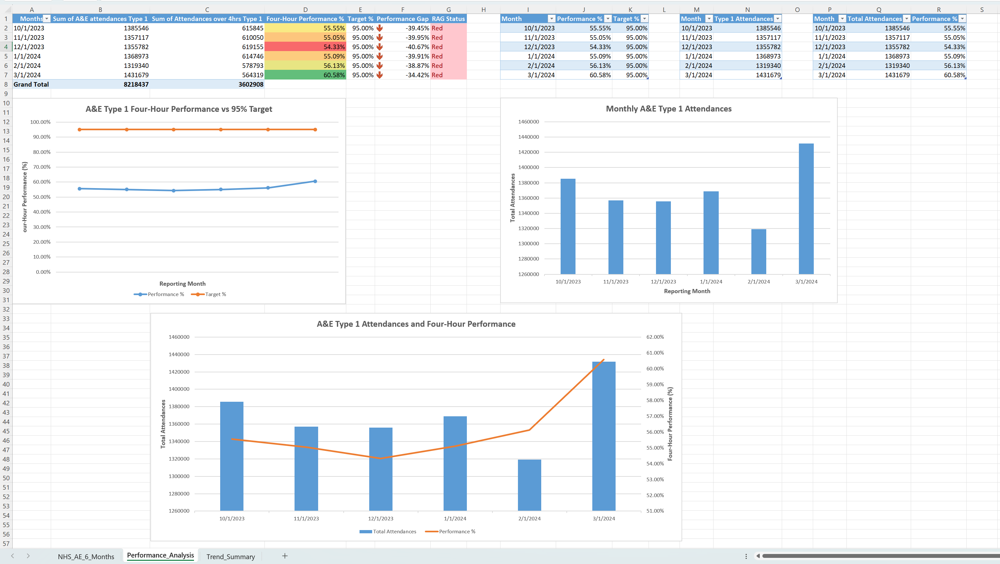
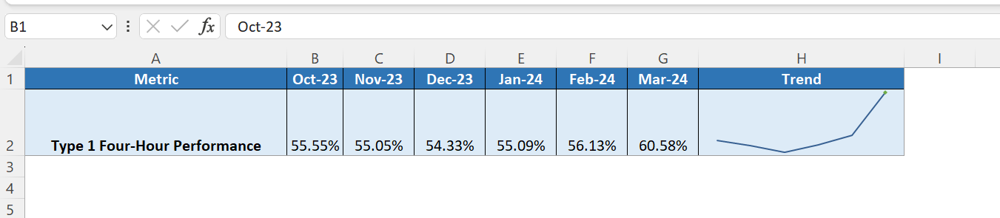

# 📊 Excel Charts & Conditional Formatting — NHS A&E Performance Analysis

## 📊 Project Overview

This independent Excel practice exercise demonstrates how Excel charts, conditional formatting, sparklines, and performance calculations can be used to analyse NHS England Accident & Emergency (A&E) data.

Using six months of NHS England provider-level data, from October 2023 to March 2024, I analysed Type 1 A&E attendances, four-hour performance, monthly trends, and performance gaps against a 95% reference target.

The objective was to practise creating clear, professional Excel reports and visualising healthcare performance data.

**Key Questions:**

- How did Type 1 four-hour performance change over six months?
- Which month recorded the highest and lowest performance?
- How far was performance from the 95% reference target?
- How did monthly Type 1 attendance volumes change?
- How can charts and conditional formatting highlight trends and performance gaps?

**Project Type:** Independent Excel learning and portfolio practice exercise.

## 🛠️ Tools & Technologies

| Tool / Feature | Purpose |
|---|---|
| Microsoft Excel | Data analysis, calculations and reporting |
| Power Query | Import and combine six monthly NHS CSV files |
| Excel Tables | Organise chart source data |
| PivotTables | Aggregate monthly attendance and waiting-time figures |
| IFERROR | Handle potential division errors |
| IF | Classify performance using RAG rules |
| Line Charts | Compare actual performance against the reference target |
| Column Charts | Compare monthly attendance volumes |
| Combo Charts | Display attendance volumes and performance percentages together |
| Secondary Axis | Show percentage and attendance measures on separate scales |
| Sparklines | Visualise six-month performance trends within a cell |
| Colour Scales | Highlight relative differences in performance |
| Icon Sets | Display directional indicators for performance gaps |
| Conditional Formatting | Highlight Red, Amber and Green status values |

## 📁 Dataset Information

**Source:** NHS England — A&E Attendances and Emergency Admissions  
**Reporting Period:** October 2023 – March 2024  
**Geographical Coverage:** England  
**Data Level:** NHS organisation/provider-level records  
**Monthly Source Files:** 6 CSV files  
**Combined Records After Filtering:** 1,203  
**Department Category Analysed:** Type 1 A&E

**Official Source:**

https://www.england.nhs.uk/statistics/statistical-work-areas/ae-waiting-times-and-activity/

### Data Preparation

1. Downloaded six monthly NHS England A&E CSV files.
2. Stored the files in the `monthly-data/` folder.
3. Imported the folder using Power Query.
4. Combined the monthly files into one dataset.
5. Removed existing aggregate `Total` records to prevent double counting.
6. Created a `Reporting_Date` column.
7. Loaded the combined data into Excel.
8. Created a PivotTable to aggregate Type 1 attendance figures by month.

### Monthly Source Data

The `monthly-data/` folder contains six NHS England CSV files covering:

| Reporting Month | Source Format |
|---|---|
| October 2023 | CSV |
| November 2023 | CSV |
| December 2023 | CSV |
| January 2024 | CSV |
| February 2024 | CSV |
| March 2024 | CSV |

The six monthly source CSV files are retained in the `monthly-data/` folder for reproducibility. Power Query was used to combine the files; refresh functionality after moving the workbook to another computer has not been independently tested.

## 📂 Workbook Structure

| Worksheet | Description |
|---|---|
| `NHS_AE_6_Months` | Combined NHS A&E data imported using Power Query |
| `Performance_Analysis` | Monthly PivotTable, four-hour performance calculations, RAG classification, conditional formatting and charts |
| `Trend_Summary` | Six-month performance summary with a formatted Sparkline |

## 🧮 Excel Formulas & Calculations

### 1. Four-Hour Performance Percentage

```excel
=IFERROR((B2-C2)/B2,0)
```

**Purpose:** Calculates the percentage of Type 1 A&E attendances that did not exceed four hours.

**Calculation:**

```text
Four-Hour Performance =
(Total Type 1 Attendances - Type 1 Attendances Over 4 Hours)
/
Total Type 1 Attendances
```

The result is formatted as a percentage.

### 2. Reference Performance Target

```excel
=95%
```

**Purpose:** Creates a consistent 95% reference benchmark for monthly performance comparisons.

### 3. Performance Gap

```excel
=D2-E2
```

**Purpose:** Measures the difference between actual four-hour performance and the 95% reference target.

The result is displayed as a percentage and interpreted as a percentage-point difference.

**Example:**

```text
Actual Performance = 60.58%
Reference Target = 95.00%

Performance Gap = -34.42 percentage points
```

### 4. RAG Performance Classification

```excel
=IF(D2>=95%,"Green",IF(D2>=90%,"Amber","Red"))
```

**Purpose:** Classifies performance into Red, Amber and Green categories.

| Status | Performance |
|---|---|
| Green | 95% or above |
| Amber | 90% to below 95% |
| Red | Below 90% |

These thresholds are illustrative rules for this Excel exercise and are not official NHS RAG classifications.

### 5. Chart Source References

**Performance Trend:**

```excel
=A2
=D2
=E2
```

**Monthly Attendances:**

```excel
=A2
=B2
```

**Combo Chart:**

```excel
=A2
=B2
=D2
```

**Purpose:** Creates separate Excel Tables for chart data without changing the underlying PivotTable fields.

### 6. Sparkline Data References

```excel
=Performance_Analysis!D2
=Performance_Analysis!D3
=Performance_Analysis!D4
=Performance_Analysis!D5
=Performance_Analysis!D6
=Performance_Analysis!D7
```

**Purpose:** Links the monthly performance results to a horizontal six-month trend summary.

The Sparkline uses the six percentage values to display performance changes.

### 7. Icon Set Thresholds

The Performance Gap column uses three directional icons.

| Icon | Condition |
|---|---|
| Green upward arrow | Gap >= 0 |
| Yellow horizontal arrow | Gap >= -0.05 and below 0 |
| Red downward arrow | Gap below -0.05 |

The thresholds use Excel numeric values, where `-0.05` represents a gap of minus five percentage points.

## 📈 Performance Analysis Results

### Monthly Type 1 Four-Hour Performance

| Month | Four-Hour Performance | Reference Target | Performance Gap |
|---|---:|---:|---:|
| Oct 2023 | 55.55% | 95.00% | -39.45 pp |
| Nov 2023 | 55.05% | 95.00% | -39.95 pp |
| Dec 2023 | 54.33% | 95.00% | -40.67 pp |
| Jan 2024 | 55.09% | 95.00% | -39.91 pp |
| Feb 2024 | 56.13% | 95.00% | -38.87 pp |
| Mar 2024 | 60.58% | 95.00% | -34.42 pp |

### Attendance Summary

| KPI | Result |
|---|---:|
| Total Type 1 Attendances | 8,218,437 |
| Type 1 Attendances Over Four Hours | 3,602,908 |
| Highest Monthly Attendance | March 2024 — 1,431,679 |
| Lowest Monthly Performance | December 2023 — 54.33% |
| Highest Monthly Performance | March 2024 — 60.58% |
| October-to-March Performance Improvement | +5.03 percentage points |
| Reference Target | 95% |

## 🔍 Key Findings

### Finding 1 — Four-Hour Performance Improved

Type 1 four-hour performance increased from **55.55% in October 2023** to **60.58% in March 2024**.

This represents an improvement of approximately **5.03 percentage points**.

Performance declined during the first three months before improving from January to March 2024.

### Finding 2 — Performance Remained Below the Reference Target

December 2023 recorded the lowest four-hour performance at **54.33%**.

March 2024 recorded the highest performance at **60.58%**.

Despite this improvement, March performance remained **34.42 percentage points below** the 95% reference target.

All six reporting months were classified as Red using the exercise's illustrative RAG thresholds.

### Finding 3 — Attendance Volumes Fluctuated

The dataset recorded **8,218,437 Type 1 A&E attendances** across the six-month period.

Of these, **3,602,908 attendances** exceeded four hours.

March 2024 recorded the highest monthly attendance volume, with **1,431,679 Type 1 attendances**.

The charts demonstrate how attendance volumes and performance percentages can be analysed together.

## 📊 Data Visualisation

### Line Chart — Four-Hour Performance vs 95% Target

A line chart was created to compare monthly Type 1 four-hour performance against the 95% reference target.

The chart includes actual performance, a horizontal reference target and reporting months.

### Column Chart — Monthly A&E Attendances

A clustered column chart was created to compare Type 1 attendance volumes across the six reporting months.

### Combo Chart — Attendances and Performance

A combination chart displays monthly attendance volumes as columns and four-hour performance percentages as a line.

A secondary vertical axis separates attendance counts from percentage values.

### Sparkline — Six-Month Performance Trend

A Line Sparkline was created in the `Trend_Summary` worksheet.

The highest performance point is highlighted to show the strongest month.

## 🎨 Conditional Formatting

### RAG Status

Conditional formatting automatically highlights performance classifications:

- Red for below 90%
- Amber for 90% to below 95%
- Green for 95% or above

### Colour Scales

A Red–Yellow–Green colour scale was applied to monthly performance percentages.

The colour scale represents relative performance within the selected six-month range, not achievement of the 95% target.

### Icon Sets

Directional arrow icons were applied to the performance-gap column.

These icons help identify whether monthly performance meets or falls below the reference target.

## 🎯 Skills Demonstrated

- Importing multiple CSV files using Power Query
- Combining monthly NHS England datasets
- Filtering aggregate Total records
- Creating reporting dates
- Building monthly PivotTables
- Calculating four-hour performance percentages
- Measuring percentage-point performance gaps
- Using IF and IFERROR formulas
- Creating structured Excel Tables
- Building and formatting line charts
- Creating clustered column charts
- Building combo charts with secondary axes
- Creating and formatting Sparklines
- Applying RAG conditional formatting
- Configuring colour scales and icon sets
- Organising charts into a professional reporting layout
- Documenting analysis results and key findings

## 🖼️ Excel Practice Preview

### Performance Analysis and Charts



*Monthly Type 1 four-hour performance, 95% reference target, attendance charts, combo chart, RAG status and conditional formatting.*

### Six-Month Performance Sparkline



*Six-month Type 1 four-hour performance summary with a Sparkline highlighting the highest performance point.*

## 📂 Project Files

| File / Folder | Description |
|---|---|
| `charts_conditional_formatting.xlsx` | Excel workbook containing combined data, calculations, charts, conditional formatting and Sparkline |
| `monthly-data/` | Six original monthly NHS England A&E CSV files |
| `screenshots/performance_analysis.png` | Main analysis worksheet with three charts |
| `screenshots/trend_summary.png` | Six-month performance summary and Sparkline |
| `README.md` | Project documentation, formulas, findings and learning outcomes |

## 📚 Learning Outcome

This exercise strengthened my understanding of how Excel charts and conditional formatting can be used to communicate healthcare performance data.

I practised combining multiple monthly datasets using Power Query, calculating performance indicators, creating chart-ready tables, and building different chart types.

I also learned how to use a secondary axis to compare measures with different scales, create compact Sparklines, and apply conditional formatting to highlight performance differences.

The project demonstrates practical Excel reporting and visualisation skills using real-world published data.

## ⚠️ Important Notes

- This is an independent Excel portfolio practice exercise, not an official NHS England performance report.
- The analysis covers October 2023 to March 2024 only.
- Calculations focus on Type 1 A&E attendances and should not be interpreted as overall A&E four-hour performance.
- Published aggregate Total records were excluded to avoid double counting.
- The 95% line is a reference benchmark used for this exercise.
- RAG thresholds are illustrative and do not represent official NHS classifications.
- Colour scales compare values relative to the selected range.
- The project is intended to demonstrate Excel skills rather than provide clinical or operational recommendations.

## 📌 Data Source

**NHS England — A&E Attendances and Emergency Admissions**

https://www.england.nhs.uk/statistics/statistical-work-areas/ae-waiting-times-and-activity/
