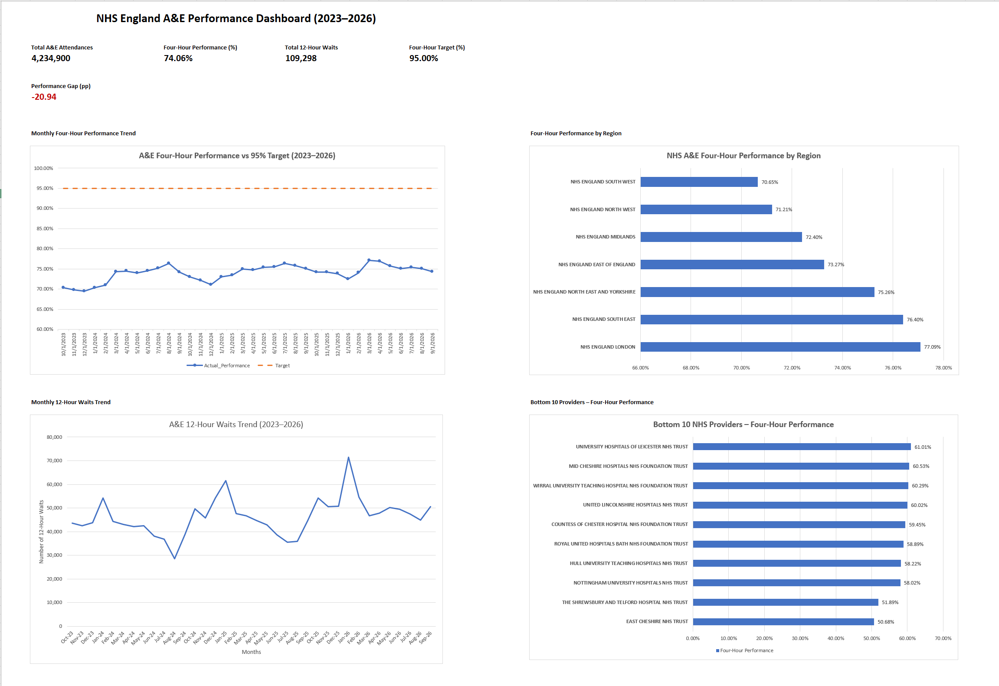

# NHS England A&E Performance Dashboard (2023–2026)

## 📊 Project Overview

I developed an Excel-based NHS England Accident & Emergency (A&E) performance dashboard to analyse four-hour waiting-time performance, 12-hour waits, regional differences, and provider-level performance between October 2023 and September 2026.

The objective was to transform monthly NHS England A&E data into a structured analytical workbook and create a dashboard that helps answer three key questions:

- How has four-hour A&E performance changed over the reporting period?
- Which NHS England regions are furthest from the 95% four-hour standard?
- Which NHS providers have the lowest four-hour performance?

This is a practical Excel data analysis and dashboard development exercise using publicly available NHS England data.

---

## 🛠️ Tools & Technologies

| Tool | Purpose |
|---|---|
| Microsoft Excel | Data analysis, calculations, and dashboard development |
| Power Query | Importing, combining, and transforming monthly datasets |
| PivotTables | Aggregating and summarising A&E performance |
| Excel Formulas | Calculating percentages, targets, and performance gaps |
| PivotCharts and Excel Charts | Visualising performance trends and comparisons |
| Conditional Formatting | Highlighting performance differences |

---

## 📁 Dataset Information

**Source:** NHS England – A&E Attendances and Emergency Admissions

**Reporting Period:** October 2023 – September 2026

**Geographical Coverage:** England

**Data Level:** Monthly NHS provider-level records

**Official Source:** https://www.england.nhs.uk/statistics/statistical-work-areas/ae-waiting-times-and-activity/

The dataset contains information relating to:

- A&E attendances
- Patients seen within four hours
- Patients waiting 12 hours or longer
- NHS provider organisations
- NHS England regional groupings
- Monthly reporting periods

The monthly files were combined into a Power Query dataset named `NHS_AE_Combined`.

**Data preparation note:** National total rows identified using `Org Code = TOTAL` were excluded from the combined provider-level dataset to avoid double-counting during analysis.

---

## 🧹 Data Cleaning & Transformation Using Power Query

The following data preparation tasks were performed in Microsoft Excel Power Query.

### 1. Importing Monthly Files

Imported monthly NHS England A&E data files into Power Query.

### 2. Combining Datasets

Combined monthly datasets into one consolidated table to support analysis across multiple years.

### 3. Data Type Validation

Reviewed relevant columns and assigned appropriate data types for:

- Dates
- Organisation identifiers
- Organisation names
- Attendance counts
- Waiting-time counts

### 4. Removing National Total Rows

Excluded records where the organisation code was `TOTAL` to avoid combining national summary rows with provider-level records.

### 5. Preparing the Analytical Dataset

Loaded the consolidated data into Excel for PivotTable analysis, calculations, and dashboard development.

### 6. Refreshable Data Workflow

Used Power Query to establish a repeatable data preparation process.

The combined dataset can be refreshed when its configured source files are updated.

---

## 🧮 Excel Formulas & Calculations

The following calculations were used to analyse A&E performance.

### 1. Four-Hour Performance (%)

```excel
=IFERROR(C2/B2,0)
```

**Purpose:** Calculates the proportion of A&E attendances completed within four hours.

**Calculation:**

Four-Hour Performance = Attendances Within Four Hours / Total Attendances

The result is formatted as a percentage.

### 2. Four-Hour Performance Target

```excel
=95%
```

**Purpose:** Establishes the 95% benchmark used to compare actual four-hour performance.

### 3. Performance Gap (Percentage Points)

```excel
=(Actual_Performance-Target_Performance)*100
```

**Example:**

```excel
=(74.06%-95%)*100
```

**Result:** -20.94 percentage points.

A negative value indicates performance below the benchmark.

**Note:** This formula produces a percentage-point value and should be formatted as a number rather than a percentage.

### 4. Error Handling

```excel
=IFERROR(C2/B2,0)
```

The `IFERROR` function prevents division-by-zero errors when calculating performance percentages.

---

## 📊 PivotTables & Data Analysis

PivotTables were created to summarise the combined NHS England dataset.

### Monthly Attendance Analysis

Aggregated total A&E attendances by reporting month to examine changes in activity.

### Four-Hour Performance Analysis

Summarised monthly attendance counts and attendances completed within four hours to calculate performance percentages.

### Twelve-Hour Waits Analysis

Aggregated monthly 12-hour waiting-time counts to identify fluctuations and periods of increased pressure.

### Provider Performance Analysis

Compared NHS provider organisations using:

- Total A&E attendances
- Attendances within four hours
- Four-hour performance percentage
- Performance gap against the 95% target

Providers with zero attendances were excluded from the performance ranking.

### Regional Performance Analysis

Aggregated performance across seven NHS England regional groupings to compare four-hour performance geographically.

---

## 📈 Dashboard KPIs

The dashboard includes five headline performance indicators.

| KPI | Value |
|---|---:|
| Total A&E Attendances | 4,234,900 |
| Four-Hour Performance | 74.06% |
| Total 12-Hour Waits | 109,298 |
| Four-Hour Performance Target | 95.00% |
| Performance Gap | -20.94 percentage points |

These values represent the KPI figures displayed in the completed Excel dashboard.

---

## 📉 Dashboard Visualizations

### 1. Monthly Four-Hour Performance Trend

A line chart comparing monthly four-hour performance against the 95% target between October 2023 and September 2026.

**Purpose:** Identify performance changes over time and determine whether monthly performance reaches the benchmark.

### 2. Four-Hour Performance by Region

A horizontal bar chart comparing seven NHS England regions.

**Purpose:** Identify regional differences and highlight the regions furthest from the four-hour performance standard.

### 3. Monthly 12-Hour Waits Trend

A line chart showing monthly changes in reported 12-hour waits.

**Purpose:** Identify fluctuations and periods of increased waiting-time pressure.

### 4. Bottom 10 NHS Providers – Four-Hour Performance

A horizontal bar chart showing the ten lowest-performing providers in the analysed dataset.

**Purpose:** Identify providers with the largest performance challenges relative to the four-hour standard.

### 5. KPI Summary

Five headline metrics provide a quick overview of overall A&E activity and performance.

---

## 🔍 Key Findings

### Finding 1: Four-Hour Performance Remained Below the 95% Standard

The dashboard reports overall four-hour performance of **74.06%**, representing a gap of **20.94 percentage points below the 95% benchmark**.

Monthly performance fluctuated across the reporting period, generally remaining in the range of approximately 69% to 77%.

Although performance improved during parts of the period, the monthly trend remained consistently below the benchmark.

### Finding 2: South West and North West Recorded the Lowest Regional Performance

Regional analysis identified substantial variation in four-hour performance.

| NHS England Region | Four-Hour Performance |
|---|---:|
| South West | 70.65% |
| North West | 71.21% |
| Midlands | 72.40% |
| East of England | 73.27% |
| North East and Yorkshire | 75.26% |
| South East | 76.40% |
| London | 77.09% |

The South West recorded the lowest performance at **70.65%**, followed by the North West at **71.21%**.

London recorded the highest regional performance at **77.09%**, although it also remained below the 95% benchmark.

### Finding 3: Significant Differences Exist Between NHS Providers

Provider-level analysis identified substantial variation in four-hour performance.

The ten lowest-performing providers were:

| Rank | NHS Provider | Four-Hour Performance |
|---:|---|---:|
| 1 | East Cheshire NHS Trust | 50.68% |
| 2 | The Shrewsbury and Telford Hospital NHS Trust | 51.89% |
| 3 | Nottingham University Hospitals NHS Trust | 58.02% |
| 4 | Hull University Teaching Hospitals NHS Trust | 58.22% |
| 5 | Royal United Hospitals Bath NHS Foundation Trust | 58.89% |
| 6 | Countess of Chester Hospital NHS Foundation Trust | 59.45% |
| 7 | United Lincolnshire Hospitals NHS Trust | 60.02% |
| 8 | Wirral University Teaching Hospital NHS Foundation Trust | 60.29% |
| 9 | Mid Cheshire Hospitals NHS Foundation Trust | 60.53% |
| 10 | University Hospitals of Leicester NHS Trust | 61.01% |

East Cheshire NHS Trust recorded the lowest four-hour performance at **50.68%**, which is **44.32 percentage points below the benchmark**.

These results demonstrate the importance of provider-level analysis alongside national and regional performance reporting.

---

## 🎯 Skills Demonstrated

- Microsoft Excel Data Analysis
- Power Query Data Import and Transformation
- Combining Multiple Monthly Datasets
- Data Type Validation
- Data Cleaning
- PivotTable Creation
- PivotTable Filtering
- Data Aggregation
- Excel Percentage Calculations
- `IFERROR` Function
- KPI Development
- Performance Gap Analysis
- Time-Series Analysis
- Regional Performance Comparison
- Provider Ranking
- Line Charts
- Horizontal Bar Charts
- Conditional Formatting
- Dashboard Design and Layout
- Excel Print Area and Page Setup
- Data Interpretation
- Analytical Reporting

---

## 🖼️ Dashboard Preview



The dashboard presents four-hour performance trends, regional comparisons, monthly 12-hour waits, and the ten lowest-performing NHS providers.

---

## 📂 Project Files

| File | Description |
|---|---|
| `NHS_AE_Dashboard.xlsx` | Excel workbook containing the data, PivotTables, calculations, charts, and dashboard |
| `screenshots/dashboard.png` | Screenshot of the completed NHS A&E dashboard |
| `README.md` | Project documentation |
| `data/` | Source data directory, where applicable |

---

## 📚 Learning Outcome

This Excel practice project helped me develop practical experience in preparing and analysing multi-year NHS England A&E performance data.

I strengthened my understanding of Power Query, PivotTables, performance calculations, provider-level comparisons, and dashboard development.

I also practised interpreting healthcare operational performance, identifying regional variations, and presenting findings through clear visualizations.

The project demonstrates how Microsoft Excel can be used to transform publicly available operational data into meaningful performance reporting.

---

## ⚠️ Important Notes

- This is an independent Excel portfolio practice exercise and is not an official NHS England performance report.
- The dashboard uses the 95% four-hour standard as its comparison benchmark.
- Provider rankings depend on the included organisations, reporting periods, and attendance definitions.
- The headline KPI values should be reconciled with the full combined dataset before the report is published.
- The workbook's charts and KPI cells may use different source ranges; users should verify consistency before drawing national conclusions.

---

## 📌 Data Source

**NHS England – A&E Attendances and Emergency Admissions**

https://www.england.nhs.uk/statistics/statistical-work-areas/ae-waiting-times-and-activity/
