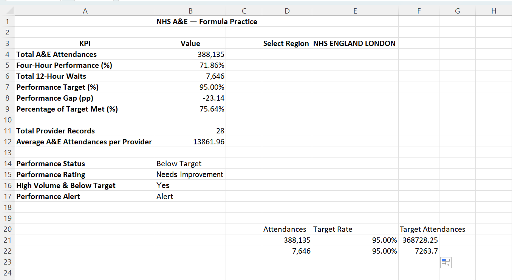
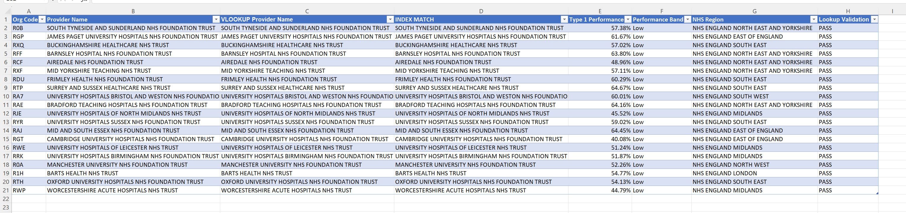
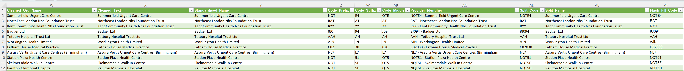
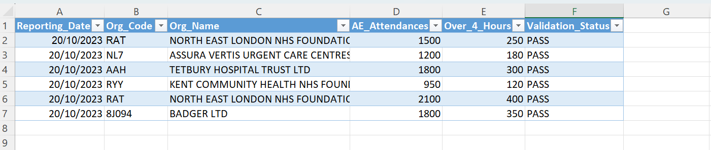
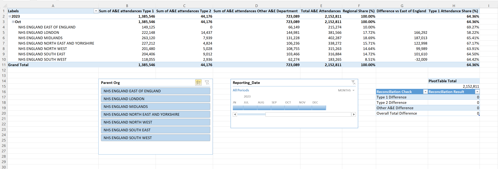
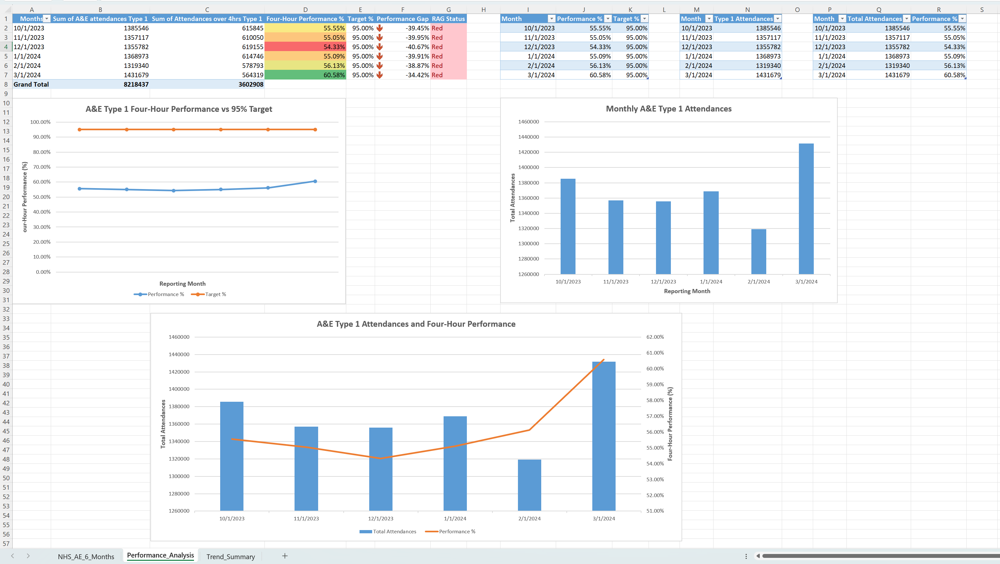
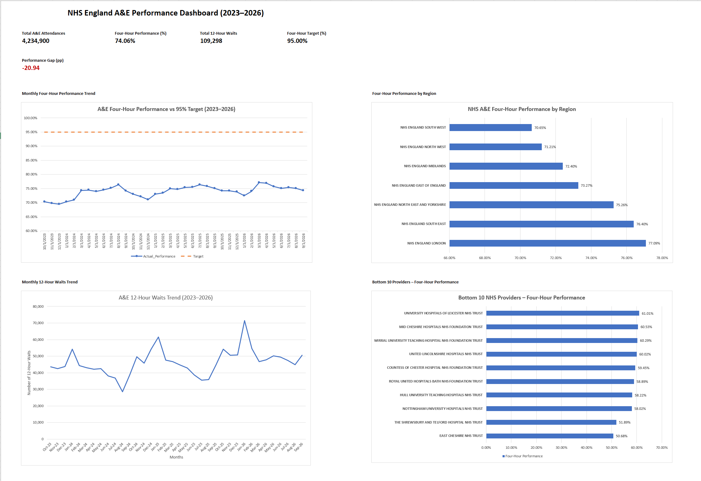

# 📊 Excel Practice Portfolio — NHS England A&E Data

A hands-on Microsoft Excel portfolio demonstrating practical data analysis, data cleaning, reporting, and dashboard development using publicly available **NHS England A&E Attendances and Emergency Admissions** data.

The portfolio is organised into 10 topic-based projects, progressing from essential Excel formulas to advanced analytical techniques, Power Query, data modelling, and interactive dashboards.

Each completed project includes a practice workbook, supporting screenshots, and a dedicated README documenting the tasks, Excel features used, and their practical applications.

> **Project type:** Independent Excel learning and portfolio practice. This repository is not affiliated with NHS England and does not represent official NHS reporting.

---

## 🗂️ Project Index

| # | Project & Key Skills | Practical Application | Preview |
|:---:|---|---|:---:|
| 01 | **[Formulas & Functions](01-formulas-and-functions/)**<br><sub>Relative/absolute references, IF, IFS, AND, OR, SUMIFS, COUNTIFS, AVERAGEIFS, IFERROR, ROUND</sub> | Build a region-driven KPI summary and evaluate performance against the 95% four-hour target. | <a href="01-formulas-and-functions/"></a> |
| 02 | **[Lookups](02-lookups/)**<br><sub>XLOOKUP, VLOOKUP, INDEX/MATCH, approximate-match lookups</sub> | Retrieve organisation names and NHS regions, classify performance into bands, and compare lookup methods. | <a href="02-lookups/"></a> |
| 03 | **[Data Cleaning](03-data-cleaning/)**<br><sub>TRIM, CLEAN, PROPER, SUBSTITUTE, TEXTSPLIT compatibility test, TEXTJOIN, LEFT, MID, RIGHT, Text to Columns, Remove Duplicates, Flash Fill</sub> | Clean inconsistent data, standardise text and dates, remove duplicates, and document data-quality issues and fixes. | <a href="03-data-cleaning/"></a> |
| 04 | **[Tables & Data Validation](04-tables-and-data-validation/)**<br><sub>Excel Tables, structured references, named ranges, drop-down lists, validation rules, sheet protection</sub> | Develop a controlled data-entry worksheet to prevent invalid dates, organisation codes, and numerical values. | <a href="04-tables-and-data-validation/"></a> |
| 05 | **[Pivot Tables](05-pivot-tables/)**<br><sub>PivotTables, date grouping, value calculations, calculated fields, slicers, timelines, PivotCharts</sub> | Summarise NHS activity by region, analyse performance, and reconcile aggregated figures against source data. | <a href="05-pivot-tables/"></a> |
| 06 | **[Charts & Conditional Formatting](06-charts-and-conditional-formatting/)**<br><sub>Line, column and combo charts, secondary axes, sparklines, colour scales, icon sets, RAG rules</sub> | Visualise six-month A&E performance trends, compare results against targets, and highlight performance categories. | <a href="06-charts-and-conditional-formatting/"></a> |
| 07 | **Power Query — 🚧 In Progress**<br><sub>CSV and folder imports, append, merge, unpivot, group by, data types, refresh</sub> | Combine 12 monthly NHS files into a consolidated, refreshable dataset. | *In progress* |
| 08 | **Dynamic Arrays — 📋 Planned**<br><sub>FILTER, SORT, SORTBY, UNIQUE, SEQUENCE, LET</sub> | Create a dynamic top-10 performance report controlled by a drop-down selection. | *Planned* |
| 09 | **Data Model & Power Pivot — 📋 Planned**<br><sub>Table relationships, measures, Data Model PivotTables</sub> | Analyse related tables through a data model without relying on worksheet lookup formulas. | *Planned* |
| 10 | **[Dashboard Exercise](10-dashboard-exercise/)**<br><sub>Dashboard design, KPI calculations, charts, slicers, reporting layout, print setup</sub> | Develop a one-page interactive dashboard analysing NHS A&E activity and performance from October 2023 to September 2026. | <a href="10-dashboard-exercise/"></a> |

**Project status:** 7 completed · 1 in progress · 2 planned

---

## 📁 Repository Structure

```text
excel-practice/
│
├── README.md
│
├── data/
│   ├── README.md
│   └── NHS_AE_Source_Files/
│       └── 36 monthly NHS CSV files
│
├── 01-formulas-and-functions/
├── 02-lookups/
├── 03-data-cleaning/
├── 04-tables-and-data-validation/
├── 05-pivot-tables/
├── 06-charts-and-conditional-formatting/
├── 07-power-query/                    # In progress
├── 08-dynamic-arrays/                 # Planned
├── 09-data-model-and-power-pivot/     # Planned
└── 10-dashboard-exercise/
```

Completed project folders generally follow this structure:

```text
NN-project-name/
├── practice_workbook.xlsx
├── screenshots/
│   └── project_screenshots.png
└── README.md
```

Each project README explains:

- **Objective:** The practical problem or Excel skill being explored.
- **Dataset:** The data used for the exercise.
- **Implementation:** Formulas, functions, and Excel features applied.
- **Results:** Outputs, screenshots, and relevant observations.
- **Learning outcomes:** Skills demonstrated through the exercise.

Workbook and screenshot filenames vary by project.

---

## 📌 Dataset Information

The portfolio primarily uses publicly available NHS England A&E activity data.

| Attribute | Description |
|---|---|
| Dataset | A&E Attendances and Emergency Admissions |
| Publisher | NHS England |
| Reporting period | October 2023 – September 2026 |
| Frequency | Monthly |
| Granularity | NHS provider-level data, with regional groupings |
| Source format | CSV |
| Total monthly source files | 36 |
| Primary analysis tool | Microsoft Excel |

**Official data source:** [NHS England — A&E Waiting Times and Activity](https://www.england.nhs.uk/statistics/statistical-work-areas/ae-waiting-times-and-activity/)

The shared dataset contains 36 monthly CSV files. Individual exercises use selected subsets or prepared practice data according to their objectives.

See [data/README.md](data/README.md) for source-file details and preparation notes.

---

## 🎯 Skills Demonstrated

### Excel Formulas & Analysis

- Conditional aggregation using SUMIFS, COUNTIFS, and AVERAGEIFS.
- Logical calculations using IF, IFS, AND, and OR.
- Exact and approximate lookups across worksheets.
- KPI calculations, performance percentages, and target comparisons.

### Data Cleaning & Quality

- Text standardisation and transformation.
- Identification and removal of duplicate records.
- Data validation and controlled data entry.
- Documentation of data-quality issues and corrective actions.

### Data Summarisation & Reporting

- PivotTables and calculated summaries.
- Regional and provider-level performance analysis.
- Source-data reconciliation.
- Trend analysis and performance comparisons.

### Data Visualisation & Dashboards

- Line, column, and combination charts.
- Conditional formatting and RAG performance indicators.
- KPI reporting and dashboard layout.
- Interactive Excel reporting using PivotTables, charts, and filtering controls.

### Additional Topics Under Development

- Power Query transformations and refreshable data preparation.
- Dynamic array formulas for automated reporting.
- Relational data modelling and Power Pivot measures.

---

## 🛠️ Tools & Technologies

**Primary tool:** Microsoft Excel

**Features used across the portfolio:**

- Excel formulas and functions
- Excel Tables and data validation
- PivotTables and PivotCharts
- Conditional formatting
- Excel charts and dashboard components

**Additional learning areas:** Power Query, Dynamic Arrays, Data Model, and Power Pivot.

---

## ⚠️ Disclaimer

This repository contains independent educational projects developed using publicly available NHS England data.

The analyses, performance categories, RAG thresholds, and alert rules are created for Excel practice and should not be interpreted as official NHS classifications, clinical guidance, or published performance assessments.

All data ownership and publication rights remain with the respective original sources.

---

## 👤 Author

**Ali Raza**

MSc Computing | Data Analytics & Business Intelligence

[GitHub](https://github.com/Alirazasadaq6) · [LinkedIn](https://www.linkedin.com/in/alirazasadaq/)

---

*This portfolio is developed as part of continuous practical learning in Excel, data analysis, and business intelligence.*